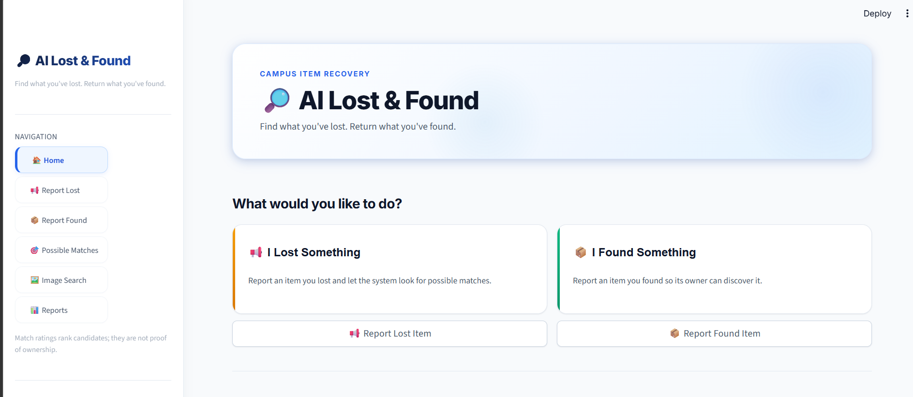
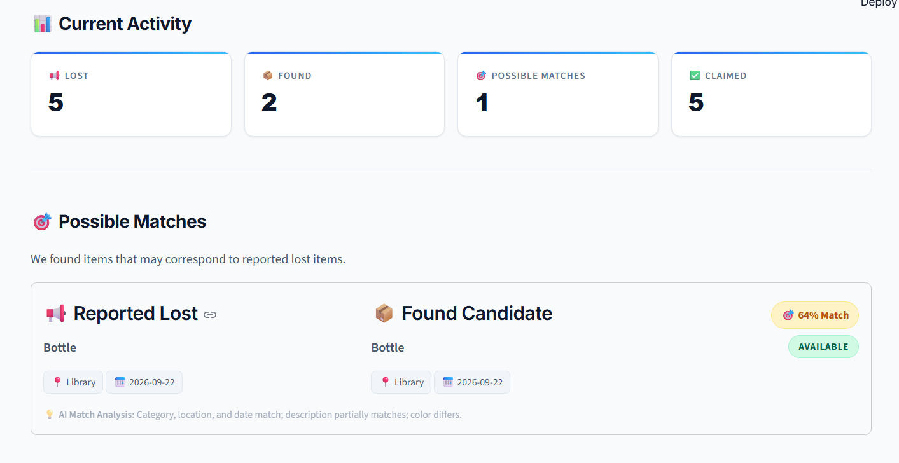
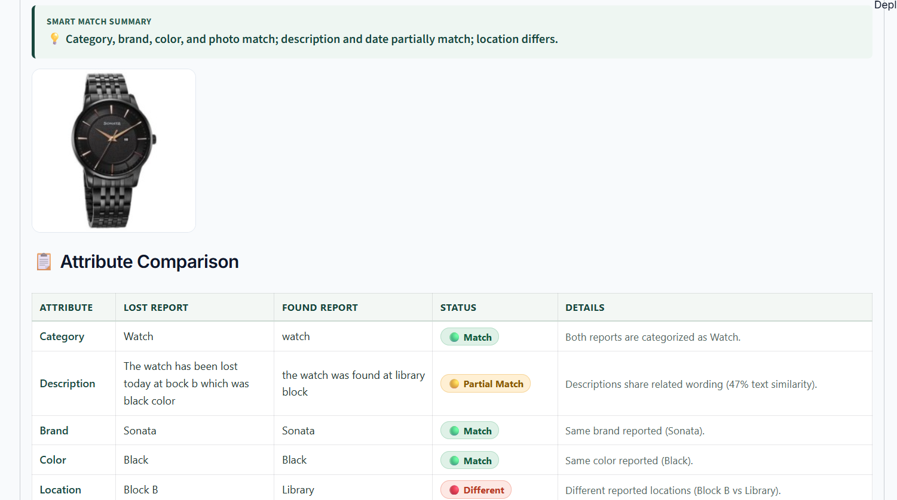
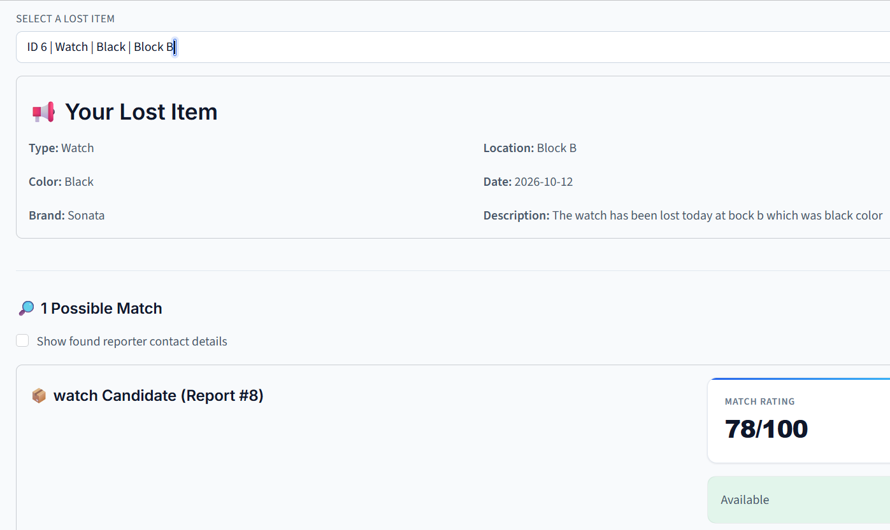
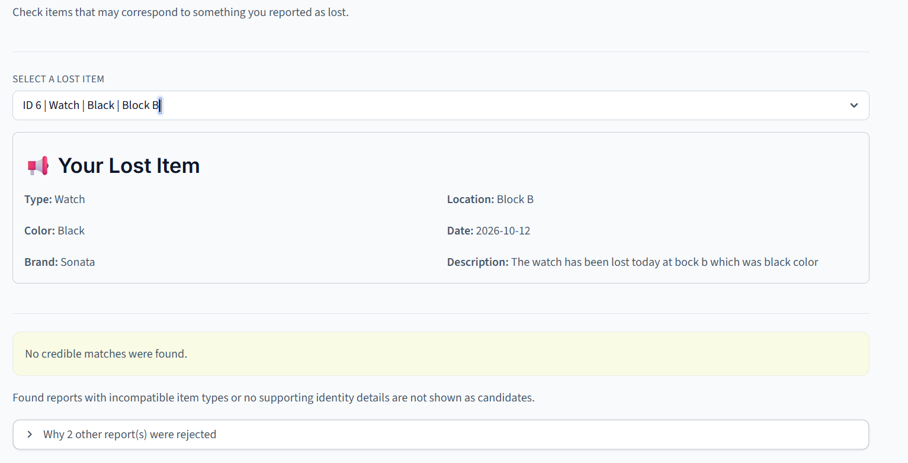
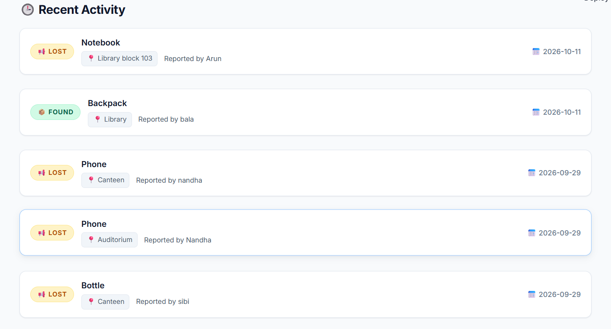
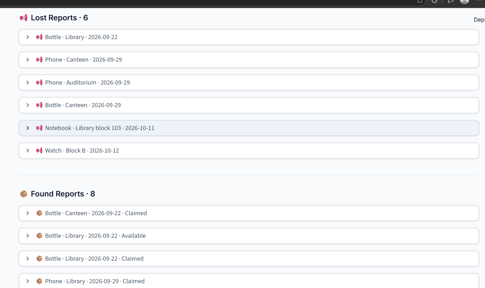

# 🔎 AI-Based Lost and Found Management System

An intelligent Lost and Found web application built with **Python and Streamlit** to help users report lost or found belongings and identify potential matches using AI-based search and similarity techniques.

The system combines **Hill Climbing, weighted multi-criteria matching, fuzzy text matching, and image similarity** to rank potential matches and make item recovery easier.

## 📸 Application Screenshots

### 1. Home Page

The home page provides an overview of the application and navigation to its main features.





### 2. Report a Lost Item

Users can submit lost-item details, including the item name, description, category, color, brand, location, date, and photograph.


### 3. Report a Found Item

Users can register found belongings so that the system can compare them with existing lost-item reports.


### 4. AI-Based Item Matching

The matching module compares lost and found reports and identifies potential matches based on multiple attributes.



### 5. Similarity Score

The system calculates a weighted similarity score to help rank potential matches.



### 6. Search and Recent Activity

Users can review matching activity and search through available item reports.





### 7. Report Management

The application provides an interface for viewing and managing item reports.



## 🏗️ System Architecture

The architecture diagram illustrates the main components of the application and how the user interface, matching algorithms, image processing, and data storage work together.


## 🎯 Objectives

- Develop a user-friendly platform for reporting lost and found belongings.
- Identify potential matches between lost and found item reports.
- Apply Hill Climbing as an AI search technique for candidate exploration.
- Combine multiple item attributes using weighted similarity scoring.
- Improve matching with fuzzy text comparison and image similarity.
- Filter and rank potential matches to assist item recovery.

## ✨ Key Features

- **Lost Item Reporting:** Submit details about missing belongings.
- **Found Item Reporting:** Register recovered or discovered belongings.
- **Hill Climbing Search:** Demonstrate local search using item similarity scores.
- **Fuzzy Text Matching:** Compare descriptions with differences in wording or spelling.
- **Image Similarity:** Use photographs as additional evidence when comparing items.
- **Weighted Multi-Criteria Matching:** Combine item type, description, brand, color, location, date, and photo similarity.
- **Credibility Filtering:** Reject candidates that do not meet configured evidence and score requirements.
- **Match Ranking:** Display potential matches in descending order of their scores.
- **Persistent Storage:** Store item reports in JSON files.
- **Interactive Interface:** Use Streamlit to provide a simple web-based experience.

## 🤖 AI Algorithms Used

### 1. Hill Climbing

Hill Climbing is used to demonstrate an AI local-search approach for finding high-scoring item candidates.

The algorithm evaluates candidates using a similarity score and moves toward a candidate with a higher score. The implementation uses multiple starting candidates and caches comparison scores.

**Why Hill Climbing?**

The primary matching objective is to identify found-item reports that are similar to a lost-item report. A* is primarily designed for cost-based pathfinding, whereas this project evaluates candidates using item similarity scores.

In the current implementation, all compatible candidates are neighbors. Therefore, Hill Climbing can inspect all candidates in one step, and direct scoring and sorting could produce the same ranking more simply.

### 2. Weighted Multi-Criteria Matching

The system calculates a combined similarity score using configurable weights for:

- Item type
- Description
- Brand
- Color
- Location
- Date
- Photograph

The combined score helps rank potential matches. Credibility checks provide additional safeguards against weak matches.

### 3. Fuzzy Text Matching

Fuzzy string similarity helps compare descriptions that contain minor spelling differences or variations in wording.

### 4. Image Similarity Matching

The image-matching module compares item photographs and provides an additional signal for identifying visually similar items.

## ⚙️ Technology Stack

| Component | Technology |
|---|---|
| Programming language | Python |
| User interface | Streamlit |
| AI search algorithm | Hill Climbing |
| Text comparison | Fuzzy string similarity |
| Image processing | Image similarity techniques |
| Data storage | JSON |
| Testing | Python test scripts |
| Version control | Git and GitHub |

## 📂 Project Structure

```text
Lost_found/
├── .streamlit/
├── Results/
│   ├── Home1.png
│   ├── Home2.png
│   ├── Lost form.png
│   ├── found form.png
│   ├── Recent_activity.png
│   ├── Report.png
│   ├── Searching.png
│   ├── matching.png
│   └── score.png
├── ai/
│   ├── astar.py
│   ├── image_match.py
│   ├── item_match.py
│   ├── smart_match.py
│   ├── hybrid_match.py
│   └── storage.py
├── data/
├── Architecuture.png
├── app.py
├── requirements.txt
├── test_astar.py
├── test_hybrid_match.py
├── test_item_match.py
├── test_matching.py
├── test_matching_workflow.py
└── test_smart_match.py
```

*This structure highlights the main application, AI modules, screenshots, and tests. Other files may also exist in the repository.*

## 🚀 Installation and Setup

### Prerequisites

- Python 3.10 or another version compatible with the project's dependencies
- pip
- Git

### Step 1: Clone the repository

```bash
git clone https://github.com/pavithra130608/Lost_found.git
cd Lost_found
```

### Step 2: Create a virtual environment

```bash
python -m venv .venv
```

Activate it on Windows:

```powershell
.venv\Scripts\Activate.ps1
```

### Step 3: Install dependencies

```bash
pip install -r requirements.txt
```

### Step 4: Run the application

```bash
streamlit run app.py
```

Open the local URL displayed in the terminal, usually:

`http://localhost:8501`

## 🧪 Running Tests

Run the relevant test scripts individually:

```bash
python test_matching.py
python test_item_match.py
python test_matching_workflow.py
python test_astar.py
```

Additional test scripts are available for the smart-matching and hybrid-matching modules.

## 🔄 Application Workflow

1. The user submits a lost-item report.
2. The system retrieves compatible found-item reports.
3. The matching module compares item attributes.
4. Similarity scores are calculated using the configured matching techniques.
5. Hill Climbing explores candidate reports using the scoring function.
6. Credibility and minimum-score checks filter potential matches.
7. The remaining candidates are ranked and displayed to the user.
8. The user verifies the details before claiming an item.

## 🔮 Future Enhancements

- Add semantic text similarity for descriptions with different wording.
- Improve image matching using visual embeddings.
- Introduce database-backed storage for larger deployments.
- Add user authentication and role-based access control.
- Notify users when a potential match is reported.
- Integrate campus maps and A* route planning to navigate to an item's reported location.

## 🎓 Applications

- Colleges and universities
- Hostels and residential communities
- Offices and workplaces
- Public facilities
- Conferences and events

## ✅ Conclusion

The AI-Based Lost and Found Management System demonstrates how AI search and similarity techniques can support item recovery. By combining Hill Climbing, weighted scoring, fuzzy text matching, and image similarity, the application helps users identify and review potential matches through an interactive web interface.

**Disclaimer:** Similarity scores indicate potential matches and do not prove ownership. Item details should be verified before an item is returned.

---

**Developed as an AI-based Lost and Found project using Python and Streamlit.**
